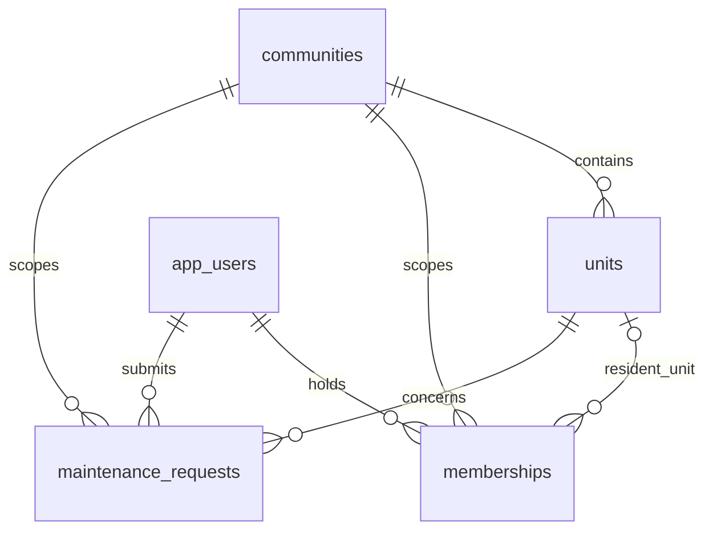

# Local schema

Liquibase applies 001_s1_local_schema.sql before test startup. `cc_test` is disposable and contains only synthetic data. No database port is published. The application does not create tables implicitly. Request visibility remains an API rule to implement; foreign keys alone do not establish authorization.

Rehearse update twice (second update is a no-op), rollback one changeset only against the disposable cc_test instance, and reapply. Never run the destructive test fixture or rollback against shared data. Future applied changesets are immutable; add a forward changeset for corrections.

S-6 schema is intentionally absent until its later implementation approval. The test contract does not assert that payments exist.

Migration recovery, remote image digests and fresh-clone execution must be recorded as actual evidence. Container version tags currently identify build inputs; immutable supply-chain pinning and SCA review remain open.
